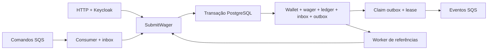

# Arquitetura e decisões

## Escopo e organização

O serviço implementa o desafio do README com Bun, TypeScript estrito, NestJS, PostgreSQL e SQS via LocalStack. Keycloak fornece identidade externa. A implementação foi construída a partir do enunciado e do plano aprovado; o fork sugerido não foi consultado.

`wallets`, `wagering` e `messaging` separam domínio, aplicação e adaptadores. Classes de domínio encapsulam invariantes e não dependem de NestJS, ORM ou AWS. Casos de uso dependem de portas pequenas; controllers validam contratos de runtime e adaptam entrada/saída. Persistência usa registros próprios e mappers, preservando a separação entre objetos financeiros e EntitySchema. HTTP e SQS chamam o mesmo `SubmitWager`.

O runtime padrão inicia HTTP e os três workers. A factory `createApplication` não cria loops: os testes e processos que precisam somente de HTTP podem compô-la isoladamente.

## Money e mapeamento

MikroORM foi escolhido pelo Unit of Work explícito, `EntityManager.transactional()`, forks e locks pessimistas. EntitySchema mapeia registros de persistência, sem decoradores ou setters públicos nas entidades de domínio. TypeORM seria uma alternativa aceita pelo desafio, mas manter dois ORMs ou usar outro adicionaria escopo sem melhorar as garantias.

Dinheiro entra e sai como `{ amount: string, currency: string }`. `Money` é imutável, usa campo privado nativo e `decimal.js` com precisão 31. Não existe conversão monetária para `number`; `NUMERIC(30,2)` é transportado como string. O máximo absoluto é `9999999999999999999999999999.99`, com 28 dígitos inteiros e duas casas. Entrada externa exige valor não negativo, duas casas exatas e moeda com três letras maiúsculas. Reidratação interna permite sinal para diferenças de reconciliação, mantendo formato e limite.

Overflow falha antes de alterar a carteira. Não há arredondamento implícito, cotação cambial ou conversão de moedas. Datas, versões, contadores e durações usam tipos próprios; não são valores monetários.

## Transação, locks e schema

Uma operação financeira confirma carteira, wager, lançamento, inbox e outbox na mesma transação SQL. Não há rede SQS dentro desse commit. Cada tentativa usa um fork do EntityManager; uma tentativa abortada não reutiliza estado de domínio já mutado.

O fluxo bloqueia a carteira antes do INSERT da wager. Essa ordem evita a promoção concorrente de locks `KEY SHARE` adquiridos pela FK para locks de atualização da mesma carteira. Operações sobre carteiras diferentes continuam independentes. Não existe mutex global, garantia financeira baseada em FIFO ou lock em memória. `lock_timeout` é limitado; deadlock, serialization e indisponibilidade reconhecida podem ser tentados novamente até três vezes, com backoff curto. Esgotamento retorna `503`, sem converter a operação em rejeição de negócio.

As migrations aplicam, além das regras de aplicação:

| Garantia | Proteção PostgreSQL |
| --- | --- |
| Uma carteira por jogador/moeda | UNIQUE `(player_id, currency)` |
| Identidade externa | UNIQUE `(provider_id, external_transaction_id)` |
| Chave idempotente | UNIQUE global em `idempotency_key` |
| Um lançamento por transação/carteira | UNIQUE `(wallet_id, transaction_id)` |
| Uma reversão concluída por referência | Índice parcial UNIQUE em `reference_transaction_id`, para REFUND/ROLLBACK PROCESSED |
| Saldo e valores válidos | NUMERIC, CHECK de não negatividade, exclusão de NaN e coerência aritmética do lançamento |
| Vínculos do lançamento | FKs compostas com carteira, transação e moeda |
| Ledger imutável | Privilégios UPDATE/DELETE/TRUNCATE revogados de `wager_app` e triggers que recusam alteração/exclusão/truncate |
| Inbox única | PK `(consumer_name, message_id)` |

`wager_app` não é superuser, não cria bancos e não é dono das tabelas. `wager_migrator` é usado separadamente para migrations. O papel administrativo da API não concede permissões SQL de administração. As duas migrations são reversíveis; reverter schema ou a proteção de ledger é uma operação de manutenção, não um recurso da API.

## Idempotência e snapshots

O SHA-256 é calculado sobre um payload de negócio validado, normalizado e ordenado recursivamente. Inclui provedor, identidade externa, jogador, carteira, rodada, jogo, tipo, Money e referência. Correlação e metadados de transporte não alteram esse hash.

`externalTransactionId` tem escopo por provedor; `Idempotency-Key` é global. Duas identidades que apontam para operações diferentes resultam em `IDEMPOTENCY_IDENTITY_CONFLICT`; conteúdo diferente na identidade existente resulta em `IDEMPOTENCY_PAYLOAD_CONFLICT`. A aplicação recupera somente violações de unicidade conhecidas, em uma nova transação, sem consultar dentro de uma SQL já abortada.

O resultado persistido guarda o saldo da execução e o status HTTP. Replay de uma operação terminal devolve esse snapshot mesmo após outras movimentações; não recalcula o saldo nem cria novo lançamento/evento. Replay de PENDING_REFERENCE não executa a regra novamente. O worker interno pode avançar a mesma pendência e atualizar seu resultado persistido; os replays posteriores observam esse novo resultado confirmado.

## Regras financeiras e referências

| Operação | Efeito |
| --- | --- |
| Abertura positiva | OPENING, crédito no ledger, eventos e versão inicial 1 |
| Abertura zero | Carteira versão 1, sem OPENING, lançamento ou WalletBalanceChanged |
| BET | Débito positivo, rejeitado se não houver saldo |
| WIN | Crédito positivo; referência BET opcional |
| LOSS | Somente `0.00`; transação/evento, sem lançamento ou mudança de versão/saldo |
| REFUND | Crédito integral de uma BET processada |
| ROLLBACK | Inverte integralmente BET, WIN ou REFUND processada |

Referência deve pertencer ao mesmo provedor, jogador, carteira, moeda e rodada. WIN referenciada pode ter valor e gameId diferentes da BET. REFUND e ROLLBACK exigem valor integral igual ao da referência. Uma referência ausente ou ainda pendente gera PENDING_REFERENCE; uma referência terminal não processada é rejeitada.

A regra aprovada permite uma única reversão concluída da mesma referência, somando REFUND e ROLLBACK. A primeira rejeição não consome essa oportunidade. Fazer rollback de um REFUND não reabre a BET original para outra reversão; ROLLBACK não é alvo de outra reversão. Reversões que debitam precisam de saldo disponível e podem ser rejeitadas com `REVERSAL_INSUFFICIENT_FUNDS`.

O worker seleciona pendências com lease e `SKIP LOCKED`, confirma a seleção e libera seu lock antes de aguardar a carteira. Depois bloqueia carteira e pendência atualizada, valida owner/status/prazo e reutiliza a regra financeira. Não cria outra wager ou inbox. O contexto original vem do PendingReference persistido na outbox. Produção usa relógio PostgreSQL após os locks para fencing e TTL, evitando divergência entre relógios dos processos.

Backoff de referência começa em 1 s, tem teto de 5 min e respeita deadline de 24 h. Expiração confirma uma única rejeição `REFERENCE_EXPIRED`. Tentativas de espera não repetem o evento PendingReference. Relógio injetado permite testar prazo sem esperar horas.

## Inbox, ACK, retry e DLQ

O consumidor valida o envelope `WagerTransactionRequested` e distingue `messageId` de domínio do `MessageId` atribuído pelo broker. O hash da inbox inclui todo o envelope validado, inclusive horário e chave; ordem JSON não muda o resultado. Conteúdo divergente para a mesma inbox é conflito e não recebe ACK. Uma mensagem nova para a mesma wager pode confirmar sua própria inbox sem repetir o efeito.

`DeleteMessage` acontece somente após commit confirmado. PENDING_REFERENCE persistida é aceita e recebe ACK, ficando sob responsabilidade do worker de referências. Long polling é limitado, o prazo de Receive é maior que sua espera e a visibilidade é renovada durante processamento. Antes de buscar mensagens, uma sonda SQL com backoff evita consumir artificialmente as cinco tentativas durante indisponibilidade do banco.

Erros de negócio são resultados confirmados. Falhas transitórias mantêm a origem para retry. Apenas falha técnica permanente atribuível a operação válida permite uma nova SQL com FAILED, código `PERMANENT_INFRASTRUCTURE_FAILURE`, resultado 500 e inbox, após rollback da tentativa anterior; não altera saldo/ledger e não inventa evento financeiro. 404, conflito ou indisponibilidade não reescrevem uma operação terminal.

Mensagem malformada é copiada à DLQ preservando o corpo, identidade da origem e classificação. O envio precisa confirmar `MessageId` antes de remover a origem. Falha na DLQ conserva a mensagem; crash entre envio e ACK pode duplicar a DLQ. A fila de origem também tem redrive após cinco recebimentos. Não há promessa de uma única entrega operacional.

SQS é a fronteira interna confiável do desafio, sem JWT por mensagem. A implantação real precisaria restringir produtores por IAM/política da fila; ainda assim, o domínio valida Money, identidade e referências.

## Outbox e entrega de eventos

Cada evento tem envelope completo e ID estável, salvo antes do commit financeiro. O publisher reivindica lote pequeno com `FOR UPDATE SKIP LOCKED`, owner token e lease PostgreSQL, confirma o claim e só então envia pela rede. `markPublished` exige owner e lease ainda válidos. Falha persiste retry com backoff de 1 s a 5 min; eventos não são descartados nem removidos prematuramente.

O envio usa exatamente o payload persistido, `aggregateId` como grupo e `eventId` como deduplication ID. Morte após envio e antes de `publishedAt` permite republicação após o lease. FIFO reduz duplicatas dentro de sua janela; a garantia permanece at-least-once. Publicações concorrentes não constituem um contrato de ordenação global dos eventos.

O consumidor demonstrativo de eventos registra eventId/hash na inbox para ignorar duplicatas, inclusive além da janela FIFO. Ele não é iniciado por padrão e não executa efeito de negócio externo. Consumidores reais precisam persistir sua própria deduplicação e lidar com reentregas.

## Keycloak e acesso

O guard global nega rotas sem política explícita. Apenas health é público. Carteiras, ledger, reconciliação e métricas exigem `wagering-admin`; submissão exige `wagering-provider` com `providerId` correspondente à claim controlada pelo IdP. Consulta de transação verifica o provedor também quando a busca usa o ID interno. Administrador pode consultar todas as transações, mas não ganha implicitamente identidade de provedor para enviar operações.

`jose` valida RS256, issuer e audience exatos, expiração e claims obrigatórias `exp`, `sub`, `aud`, `iss`, `typ`; `typ` precisa ser Bearer. Token apenas decodificado ou ID token não basta. A URL JWKS vem da configuração confiável, nunca de `jku`/`x5u` do token. Dentro do Compose, `OIDC_JWKS_URI` pode usar DNS interno mantendo o issuer público assinado.

Assinatura/claims inválidas resultam em 401; identidade válida sem acesso, 403. Falha de rede, HTTP não 200 ou resposta JWKS inválida é 503. O cache não concede autorização financeira: cada operação aplica a política. Cooldown JWKS de 5 s é um limite operacional da rotação, testada com chave RSA real do Keycloak.

Os client secrets versionados são fixtures locais. Não existe tabela de usuários/senhas própria. As credenciais de bootstrap do Keycloak e dos bancos são exclusivas de desenvolvimento/teste.

## Consultas, reconciliação e códigos

Ledger usa cursor opaco versionado, vinculado à carteira, com `(created_at, id)` em ordem decrescente. Preserva os seis dígitos de microssegundos do PostgreSQL, sem paginação por offset. Limite padrão é 50, mínimo 1 e máximo 100. Cursor inválido ou de outra carteira é 400.

Reconciliação faz um SELECT agregado em um snapshot MVCC: compara saldo materializado com créditos menos débitos e retorna `storedBalance`, `calculatedBalance`, `difference`, `consistent` e `checkedEntries`. Não corrige divergências automaticamente. Testes de corrupção controlada usam acesso administrativo somente no banco de teste e restauram o estado no finally.

Códigos de rejeição persistida: `INSUFFICIENT_FUNDS`, `REVERSAL_INSUFFICIENT_FUNDS`, `CURRENCY_MISMATCH`, `WALLET_MISMATCH`, `REFERENCE_MISMATCH`, `REFERENCE_AMOUNT_MISMATCH`, `REFERENCE_ALREADY_REVERSED`, `REFERENCE_NOT_PROCESSED`, `INVALID_REFERENCE_KIND`, `REFERENCE_EXPIRED` e `INVALID_AMOUNT`. `PERMANENT_INFRASTRUCTURE_FAILURE` acompanha FAILED técnico. Contratos inválidos são 400; rejeição de negócio, 422; ausência de recurso, 404; identidade/conteúdo conflitante, 409; indisponibilidade, 503. Replay preserva o status do resultado confirmado, inclusive 422 para rejeição e 202 enquanto pendente.

## Observabilidade e ciclo de vida

Logs próprios são JSON com lista positiva. CorrelationId e IDs conhecidos são propagados por execução, com armazenamento ALS local e snapshots imutáveis. Falhas são observadas no contexto do item, preservando o erro original. Não entram authorization, client_secret, access_token, corpo financeiro completo ou mensagens arbitrárias de erro.

Métricas têm labels enumeradas; IDs não viram labels. Contadores representam transições confirmadas observadas naquele processo, e duplicatas têm contador separado. Não são inventário global das wagers nem garantia de idempotência. Duração ausente não gera amostra zero. Lag da outbox consulta PostgreSQL e preserva a última leitura válida se o banco falhar.

Readiness verifica PostgreSQL e SQS com prazo/cancelamento; liveness permanece independente. O cancelamento SQL usa API pública e o servidor pode encerrá-lo assincronamente. Kysely emite diagnóstico próprio quando uma query abortada termina em segundo plano; a aplicação não injeta SQL ou payload nessa mensagem.

SIGTERM/SIGINT param novas buscas e drenam tarefas. Há watchdog cobrindo drain e fechamento HTTP/SQL; se o prazo esgotar, o processo sai com 1 sem declarar commit concluído. Mensagens não concluídas recuperam visibilidade; morte abrupta depende das garantias persistentes e dos leases. Compose concede 30 s ao processo, cujo prazo padrão é 25 s.

### Workaround restrito do driver

Com MikroORM 7.2.5 e Kysely 0.29.6, foi reproduzido vazamento de checkout: ControlledTransaction só libera a conexão após `rollbackTransaction` resolver; rollback em conexão perdida rejeitava e `orm.close(true)` não terminava. `RecoveringPostgreSqlDriver` decora a criação pública do dialect/driver e permite concluir esse rollback somente para sinais inequívocos de conexão morta. O erro original da operação continua propagado e o pool descarta o cliente inválido.

Erros SQL normais, constraints, serialization e cancelamento não são suprimidos por esse ajuste. Não houve patch de node_modules, acesso privado ou troca de stack. Antes de atualizar/remover o workaround, executar a regressão de queda real durante SQL: rollback sem efeito parcial, recuperação única e fechamento do pool em menos de 2 s. Removê-lo quando a versão upstream liberar o checkout também no caminho de rollback desconectado e essa regressão passar com o driver padrão.

## Limitações e escolhas

LocalStack está sem persistência de broker. Testes de stop/start SQS provam que a outbox PostgreSQL recupera eventos para a fila recriada; não demonstram durabilidade interna do broker. Não foi adicionada licença paga, outro serviço ou promessa de exactly-once.

PostgreSQL é a autoridade financeira e de coordenação distribuída. Locks pessimistas tornam o fluxo e os invariantes explícitos; uma hot wallet continua serializada por definição. Optimistic locking com recomputação seria alternativa, mas exigiria administrar mais conflitos sem eliminar essa serialização lógica. Cache, mutex global e FIFO isolado foram rejeitados como garantias de correção.

Sem distributed transaction entre PostgreSQL e SQS, inbox/outbox tornam a recuperação explícita e aceitam duplicatas operacionais. Reconciliação detecta problemas, sem inventar correções. O seed usa APIs e filas reais, cria dados novos e valida replay/reconciliação; não é carga de desempenho. Não foi realizado benchmark nem inferida capacidade de produção dos tempos de teste.

## Rastreabilidade e evidências

| Requisito | Testes |
| --- | --- |
| Stack, role restrita, serviços reais | `test/integration/environment.test.ts`, `runtime.test.ts` |
| Migrations reversíveis e constraints | `test/integration/migrations.test.ts` |
| Money, limites e precisão SQL | `test/unit/money.test.ts`, `test/integration/money-persistence.test.ts` |
| Encapsulamento, saldo e ledger | `test/unit/wallet.test.ts`, `ledger.test.ts`, `test/integration/wallet.test.ts`, `wager.test.ts` |
| Atomicidade e rollback | `test/integration/atomicity.test.ts`, `recovery.test.ts` |
| Idempotência e snapshot original | `test/unit/canonical.test.ts`, `test/integration/idempotency.test.ts`, `http.test.ts` |
| Referências, reversão única e TTL | `test/unit/rules.test.ts`, `test/integration/references.test.ts`, `reference-worker.test.ts` |
| Cursor e reconciliação | `test/unit/contracts.test.ts`, `test/integration/reconciliation.test.ts` |
| Keycloak, políticas e rotação real | `test/unit/policy.test.ts`, `verifier.test.ts`, `test/integration/identity.test.ts` |
| Inbox, ACK, retry e DLQ | `test/unit/inbox.test.ts`, `retry.test.ts`, `test/integration/inbox.test.ts`, `dlq.test.ts` |
| Outbox, leases e deduplicação de eventos | `test/unit/outbox.test.ts`, `test/integration/outbox.test.ts` |
| Logs, métricas e outages reais | `test/unit/logging.test.ts`, `test/integration/observability.test.ts`, `recovery.test.ts` |
| Três PIDs, races, restart e morte após commit/envio | `test/concurrency/processes.test.ts`, `financial-processes.test.ts`, `crash-processes.test.ts` |
| SIGTERM Linux, prazo e retomada | `test/concurrency/signals.test.ts` |
| Seed local e destinos seguros | `test/unit/seed-local.test.ts`, execução real `bun run seed:local`, `scripts/demo-http.ps1` validado contra a API real |

A verificação final passou com **259 unitários/767 asserções**, typecheck, **132 IT/950 asserções em 18 arquivos** e **14 testes nativos de concorrência/97 asserções mais dois Linux/26**, executados em invocações sequenciais. O ambiente exclusivo de testes foi recriado antes da rodada final. O preflight separado de três testes/15 asserções também passou, mas esses casos reaparecem na suíte IT e não são somados como testes únicos.

O seed real executou contra três APIs Docker saudáveis, confirmou replay, WIN SQS e reconciliação de 85.00 BRL com três lançamentos. O exemplo PowerShell versionado também foi executado contra a API real: confirmou a mesma BET no replay, saldo 75.00 BRL e dois lançamentos. A imagem foi verificada com usuário sem root, role `wager_app`, sem credencial migrator e sem arquivos de teste. `bun install --frozen-lockfile` passou sem alterar as dependências.

O checkpoint registra RED/GREEN e revisões de cada tarefa. As limitações históricas de sequência são explícitas: parte dos IT da tarefa 13 e uma primeira correção de latência da tarefa 17 antecederam suas regressões específicas. Não há alegação de que toda linha foi escrita após um RED. Novos ajustes de revisão e seed têm RED comportamental registrado; falhas de importação/infraestrutura não foram apresentadas como RED de negócio. A primeira versão do exemplo HTTP em here-string falhou por quoting no Windows; a versão final usa arquivo PowerShell e passou com o mesmo comando documentado.
